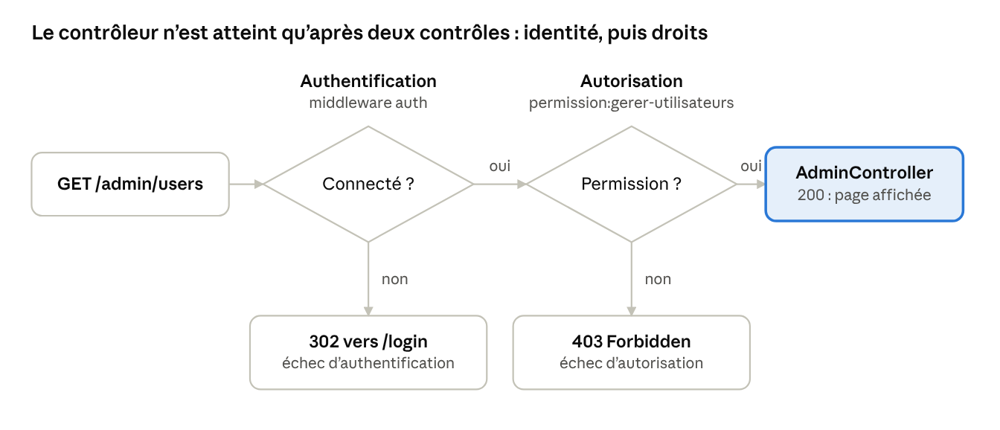

# Authentification Laravel

Fortify + Spatie

## Sommaire

- [Présentation](#présentation)
- [Étape 0 : Créer le projet et installer le contrat de tests](etape-0.md)
- [Étape 1 : Installer Spatie et préparation du modèle User](etape-1.md)
- [Étape 2 : Créer les rôles, la permission et les comptes de démonstration](etape-2.md)
- [Étape 3 : Installer Fortify](etape-3.md)
- [Étape 4 : Attribuer un rôle dès l'inscription (côté serveur)](etape-4.md)
- [Étape 5 : Déclarer les middlewares de Spatie](etape-5.md)
- [Étape 6 : Protéger les routes et créer les pages](etape-6.md)
- [Contrat de tests](contrat-de-tests.md)
- [Mémo C — Dépannage](depannage.md)
- [Bilan — Je sais le prouver](bilan.md)

# Présentation

À la fin de ce TP, votre application sera en mesure de distinguer **qui est connecté** (authentification) et **ce qu'il a le droit de faire** (autorisation). Surtout, vous savez le prouver : chaque étape se termine par une preuve à produire, pas par « ça marche ».

Vous saurez :

1. Mettre en place l'authentification avec Laravel Fortify, sans interface fournie, en n'exposant que les fonctionnalités utiles.
2. Distinguer trois profils : visiteur (non connecté), utilisateur (connecté, droits limités) et administrateur.
3. Modéliser les rôles utilisateur et administrateur avec spatie/laravel-permission, et protéger des routes par permission.
4. Adapter le contenu d'une vue au profil de la personne qui la consulte.
5. Attribuer un rôle côté serveur, et démontrer qu'un rôle injecté par le client est ignoré.
6. Expliquer et provoquer les réponses 302, 403, 405, 419 et 429 de votre application.
7. Faire passer des tests qui servent de preuve, et vérifier qu'ils détectent bien une faille.

**Contexte.** Vous partez d'un dossier vide et créez un projet Laravel 13 neuf à l'étape 0. Prérequis : PHP 8.3 ou plus récent, Composer, et l'extension PHP pdo\_sqlite.

Versions de référence:

- Laravel Framework: 13.40.0
- Fortify: 1.41.0
- Spatie: 8.5.0

**Règle d'or.** Quand un extrait montre un fichier qui existe déjà, vous **ajoutez** ce qui est indiqué. Vous ne remplacez jamais un fichier entier par un extrait : les fichiers générés contiennent des éléments dont l'application a besoin.

**Vos preuves.** Créez à la racine de votre projet (tp-auth) un fichier PREUVES.md. Vous y copierez, étape après étape, les sorties de commandes et vos observations demandées dans les rubriques « Preuve » : c'est ce fichier que le bilan vous demande de relire.

## Rappel: Authentification, autorisation et codes HTTP

Ce sont deux contrôles distincts, toujours dans cet ordre : d'abord « qui êtes-vous ? », puis « avez-vous le droit ? ». Confondre les deux introduit une faille critique dans le contrôle d'accès de votre application.

| Question | Qui êtes-vous ? | Avez-vous le droit de faire ceci ? |
| --- | --- | --- |
| Laravel | **Fortify** (connexion, inscription, session) | **Spatie** (rôles, permissions) |
| Middleware | auth | permission:… |
| Échec vu du navigateur | Redirection 302 vers /login | Erreur 403 Forbidden |

Le contrôleur (ici AdminController) ne peut être atteint qu’après deux vérifications : l’identité, puis les droits :

- Un visiteur (non authentifié) est arrêté au premier contrôle (redirection 302)
- Un utilisateur authentifié est arrêté au second (erreur 403)
- Seul un utilisateur qui a la permission pourra atteindre le contrôleur.

**Les codes HTTP couramment rencontrés :**

| Code | Signification | Exemple |
| --- | --- | --- |
| 302 | Redirection : non authentifié | Un visiteur demande /dashboard |
| 403 | Authentifié, mais non autorisé | Un utilisateur demande /admin/users |
| 405 | Méthode HTTP refusée par la route | GET /logout : la route n'accepte que POST |
| 419 | Requête POST sans origine vérifiable ni jeton CSRF | Un POST /login envoyé avec curl |
| 429 | Trop de requêtes | Sixième tentative de connexion en moins d'une minute |

## Livrables

Voici ce qui est attendu en termes de protection des routes. Ces cas devront être vérifiés par un test (étape 6).

| Route | Visiteur | Utilisateur | Administrateur |
| --- | --- | --- | --- |
| /accueil | 200 | 200 | 200 |
| /login | 200 | 302 vers /dashboard | 302 vers /dashboard |
| /dashboard | 302 vers /login | 200 | 200 |
| /admin/users | 302 vers /login | 403 | 200 |

## Qui fait quoi : Fortify, Spatie et vous

Fortify fait le travail d'authentification côté serveur, mais ne fournit aucune page. Spatie enregistre qui a quel rôle et quelles permissions, mais ne décide pas à votre place de ce qui doit être protégé.

Qui fait quoi ?

| Fortify fournit | Vous décidez ou écrivez |
| --- | --- |
| Les routes (/login, /register, /logout…) et leurs contrôleurs | Les vues Blade des formulaires |
| La vérification des identifiants et la session | Le choix des fonctionnalités actives, dans config/fortify.php |
| La limitation des tentatives de connexion | La page d'arrivée après connexion (clé home) |
| Des actions modifiables dans app/Actions/Fortify | Les règles métier, par exemple le rôle attribué à l'inscription |
