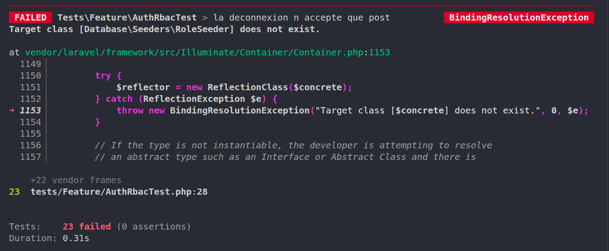

# Étape 0: Créer le projet et installer le contrat de tests

**Faire**

```bash
# Projet neuf, dernière version de Laravel (13.x)
composer create-project laravel/laravel tp-auth
cd tp-auth
php artisan --version

# Dépôt Git et branche de travail
git init && git add -A && git commit -m "Squelette Laravel 13"
git switch -c feat/auth-rbac
```

Vous commencez par les tests : ils décrivent ce que l'application devra faire à la fin. Au départ, ils échouent tous. Votre travail consiste à les faire passer un par un, sans jamais les modifier.

Créez tests/Feature/AuthRbacTest.php et copiez-y le fichier donné dans la section « Contrat de tests », plus bas, sans rien changer.

Ces tests s'appuient sur RefreshDatabase : la migration est exécutée une seule fois, puis chaque test tourne dans une transaction qui est annulée en fin de test, garantissant un état propre sans re-migrer. La base est SQLite en mémoire (:memory:) est déjà configurée dans le phpunit.xml, donc aucun fichier n'est créé sur le disque.

Preuve

```bash
php artisan test --filter=AuthRbacTest
```

Tous les tests génèrent des échec : les classes qu'ils utilisent n'existent pas encore.


