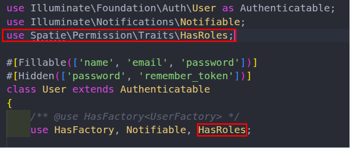

# Étape 1: Installer Spatie et préparation du modèle User

Le package spatie/laravel-permission crée cinq tables en base via une migration unique (2 tables de définition + 3 tables de liaison).

| Table | Rôle |
| --- | --- |
| permissions | Catalogue des permissions (ex. edit posts, delete users). Clé unique : name + guard\_name. |
| roles | Définition des rôles (ex. admin, editor). Chaque rôle regroupe un ensemble de permissions. |
| role\_has\_permissions | Pivot N-to-N entre rôles et permissions : Un rôle contient quel droit ? |
| model\_has\_roles | Pivot polymorphe : quel modèle (User, ApiClient…) a quel rôle. Colonnes : role\_id, model\_type, model\_id. |
| model\_has\_permissions | Pivot polymorphe : permissions attribuées directement à un modèle, sans passer par un rôle (cas rare). |

Pourquoi cette architecture ?

Les permissions ne sont pas stockées sur le modèle User, afin de permettre de réutiliser le même système pour n'importe quel modèle Eloquent (utilisateurs, API clients, service accounts…).

Le check ($user->can('edit posts')) vérifie à la fois les permissions directes (model\_has\_permissions) et celles héritées via les rôles (model\_has\_roles → role\_has\_permissions).

Le tout est mis en cache : Spatie charge les permissions en mémoire à la première vérification et invalide le cache à chaque création/modification de rôle ou permission.

En résumé (le flux)

User ──(model\_has\_roles)──► Role ──(role\_has\_permissions)──► Permission

│

└──(model\_has\_permissions)──► Permission (direct, rare)

L'utilisateur hérite de toutes les permissions de ses rôles, plus celles qu'on lui a accordées directement. C'est le pattern RBAC classique, implémenté en N-to-N polymorphe pour rester découplé du modèle utilisateur.

Faire

```bash
composer require spatie/laravel-permission
php artisan vendor:publish --provider="Spatie\Permission\PermissionServiceProvider"
php artisan config:clear
php artisan migrate
```

Dans app/Models/User.php, ajoutez **l'import** et le **trait** HasRoles.



Le trait HasRoles ajoute au modèle les méthodes de Spatie : assignRole(), hasRole(), syncRoles()… La méthode can(), déjà présente, se met à tenir compte des permissions Spatie (voir le mémo).

**Mémo:** Le trait ***HasRoles***

En PHP, une classe n’hérite que d’**une seule** classe parente. *User* hérite déjà de *Authenticatable* : impossible d’hériter en plus de la classe Spatie.

Le **trait** contourne cette limite. C’est un bloc de méthodes que PHP recopie dans la classe qui l’utilise. En écrivant *use HasRoles;* dans *User*, le modèle reçoit *roles()*, *assignRole()*, *hasRole()*, *syncRoles()*, *givePermissionTo()*… sans qu’on réécrive une ligne.

*can()*, lui, vient d’un autre trait (*Authorizable*), déjà présent dans *Authenticatable* : *HasRoles* ne le remplace pas. C’est Spatie qui, au démarrage de l’application, déclare auprès de Laravel un contrôle supplémentaire (un *Gate::before*) : avant de répondre à *can()*, Laravel interroge les permissions Spatie du modèle, grâce aux méthodes que *HasRoles* apporte à *User*. Sans le trait *HasRoles*, *can()* ignore donc les permissions Spatie.

Attention aux deux *use* : celui en haut du fichier **importe un nom** (permet d’écrire ***HasRoles*** au lieu de ***\\Spatie\\Permission\\Traits\\HasRoles***), celui dans la classe **inclut le trait** **à la classe User**.

test

```bash
php artisan db:table model_has_roles
```

Copiez la liste des colonnes dans PREUVES.md.
