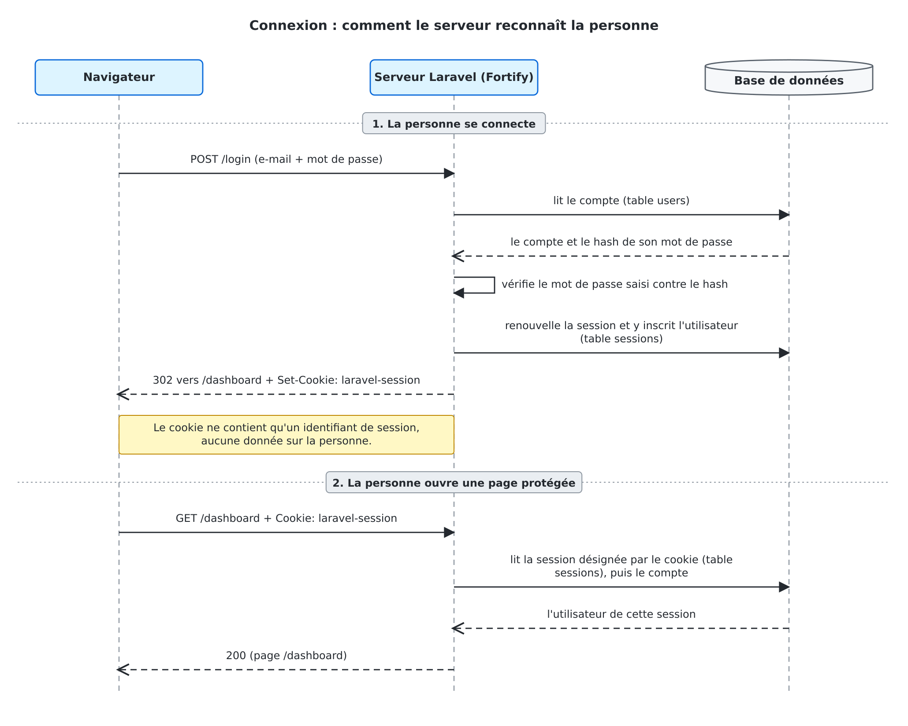

# Étape 3 : Comprendre la connexion : la session

À la fin de cette étape, vous saurez expliquer sur quelle donnée repose la phrase « cet utilisateur est connecté », et ce que la déconnexion détruit côté serveur.

HTTP n'a pas de mémoire : chaque requête arrive seule, sans lien avec la précédente. Pour répondre 200 à une personne connectée et 302 à un visiteur sur /dashboard, le serveur s'appuie sur deux éléments : une **session**, enregistrée côté serveur, et un **cookie**, conservé par le navigateur. Cette étape les montre dans la base et dans les en-têtes HTTP.



> [!NOTE]
> **Lire un diagramme de séquence.** Un **diagramme de séquence** (UML) montre des échanges dans l'ordre, de haut en bas. Chaque colonne est un acteur (ici le navigateur, Laravel et la base de données). Une flèche pleine est une demande, une flèche en pointillés une réponse.

Le serveur de développement (étape 2) doit tourner, et vous devez être déconnecté.

**Lire la table `sessions` en SQL.** Les observations 3 à 6 et l'exercice relisent plusieurs fois la table `sessions`. Le serveur occupe le premier terminal. Ouvrez un deuxième terminal dans le projet, lancez la commande ci-dessous et laissez-la ouverte : elle démarre `sqlite3`, le client SQL de la base du projet, et affiche l'invite `sqlite>`.

```bash
php artisan db
```

À l'invite, tapez ces deux commandes (elles commencent par un point et ne se terminent pas par `;`) : `.headers on` affiche les noms de colonnes, `.mode column` aligne les colonnes.

```text
.headers on
.mode column
```

Pour afficher la table, tapez cette requête SQL, terminée par `;`. Elle demande les colonnes `id` (l'identifiant de la session) et `user_id` (l'identifiant de l'utilisateur connecté, vide pour un visiteur) de toutes les lignes de la table `sessions`. `.quit` ferme `sqlite3`.

```sql
SELECT id, user_id FROM sessions;
```

Résultat, ici pour une personne connectée (vos identifiants seront différents) :

```text
id                                        user_id
----------------------------------------  -------
F0drf31Jv8aRz7n0b8Qm2YxLk4TcVhPwUe5sNgDo  1
```

Les commandes `curl` et `php artisan tinker` se lancent dans un troisième terminal.

> [!NOTE]
> **`sqlite3` absent.** Si `php artisan db` répond `sqlite3 not found in path.`, le programme `sqlite3` n'est pas installé sur votre machine. Remplacez alors `SELECT id, user_id FROM sessions;` par `php artisan tinker --execute="dump(DB::table('sessions')->get(['id', 'user_id']));"` et `DELETE FROM sessions;` par `php artisan tinker --execute="DB::table('sessions')->truncate();"` : les observations donnent les mêmes résultats.

**Observation 1 — Le mot de passe en base.**

```bash
php artisan tinker --execute="dump(DB::table('users')->get(['id', 'email', 'password']));"
```

La colonne `password` contient un hash (60 caractères, qui commence par `$2y$`), jamais le mot de passe. À la connexion, Laravel vérifie le mot de passe saisi contre ce hash : on ne « déchiffre » jamais le hash. Les deux comptes de démonstration ont le même mot de passe (`password`) et des hashes différents (voir le mémo ci-dessous).

> [!NOTE]
> **Hash, bcrypt et sel.** Un **hash** est l'empreinte irréversible d'un mot de passe : on peut vérifier qu'un mot de passe correspond à son hash, mais on ne peut pas retrouver le mot de passe à partir du hash. **bcrypt** est l'algorithme de hachage utilisé par Laravel. Le **sel** est une valeur aléatoire ajoutée au mot de passe avant le calcul et inscrite dans le hash : c'est pourquoi deux mots de passe identiques donnent deux hashes différents.

**Observation 2 — Ce que le serveur remet à un nouveau visiteur.**

```bash
curl -I http://127.0.0.1:8000/login
```

Sous Windows PowerShell, tapez `curl.exe`. L'option `-I` n'affiche que les en-têtes de la réponse. Repérez les deux lignes `Set-Cookie` :

- `laravel-session` : le cookie de session. Sa valeur est chiffrée et ne contient aucune information sur vous (ni nom, ni rôle) : seulement de quoi retrouver votre session sur le serveur. L'attribut `httponly` interdit à JavaScript de le lire.
- `XSRF-TOKEN` : un second cookie, lié à la protection CSRF.

**Observation 3 — La session d'un visiteur.** Videz d'abord la table des sessions à l'invite `sqlite>` (cela déconnecte tout le monde, c'est voulu) :

```sql
DELETE FROM sessions;
```

La commande n'affiche rien. Elle supprime toutes les lignes de la table sessions ; la ligne observée ensuite est donc forcément celle de votre navigateur.

Dans le navigateur, ouvrez http://127.0.0.1:8000/login sans vous connecter, puis affichez la table avec la requête `SELECT id, user_id FROM sessions;`.

Vous devez voir **une seule ligne**, avec `user_id` vide : un visiteur a déjà une session, que Laravel crée dès la première visite. Notez le début de son `id`. Si plusieurs lignes apparaissent, d'autres onglets ou d'autres clients (`curl`) ont visité le site : fermez-les, videz la table et rechargez /login.

**Observation 4 — La connexion.** Connectez-vous avec alice@exemple.test (mot de passe password), puis relancez la requête qui affiche la table. Vous devez voir **une seule ligne**, dont `user_id` vaut l'identifiant de alice@exemple.test (colonne `id` de l'observation 1) et dont l'`id` a **changé** : comparez-le au début d'`id` noté à l'observation 3. À la connexion, Laravel renouvelle l'identifiant de session.

Facultatif : voir ce que la session retient.

```bash
php artisan tinker --execute="dump(json_decode(base64_decode(DB::table('sessions')->value('payload')), true));"
```

On y trouve le jeton CSRF (`_token`, celui que `@csrf` place dans les formulaires, étape 2) et une clé qui commence par `login_web_`, dont la valeur est l'identifiant de l'utilisateur : c'est cette donnée qui signifie « connecté ».

> [!NOTE]
> **La colonne payload.** La colonne `payload` de la table `sessions` contient le contenu de la session, écrit en JSON puis encodé en base64 : la commande ci-dessus le décode pour vous.

> [!NOTE]
> **Fixation de session.** Attaque dans laquelle une personne malveillante obtient un identifiant de session valide *avant* la connexion de sa victime : par exemple, elle ouvre elle-même la page de connexion (ce qui crée une session de visiteur), puis fait poser ce cookie dans le navigateur de la victime. Elle garde l'identifiant et attend que la victime se connecte. La question 2.4 demande en quoi le renouvellement de l'identifiant, observé ci-dessus, empêche cette attaque.

**Observation 5 — Le cookie désigne la ligne de la table.** Vous êtes connecté (observation 4). Le cookie `laravel-session` est chiffré avec la clé `APP_KEY` du fichier .env : le navigateur ne peut ni le lire ni le modifier, seul le serveur le déchiffre. Vous allez jouer le rôle du serveur.

1. Dans le navigateur, ouvrez les outils de développement (F12), puis l'emplacement des cookies :
   - Chrome : onglet *Application*, *Cookies*, puis l'adresse du site ;
   - Firefox : onglet *Stockage*, *Cookies*, puis l'adresse du site.

   Copiez la valeur du cookie `laravel-session` : environ 340 caractères, qui ne ressemblent à aucun identifiant.
2. Dans le troisième terminal, collez cette valeur à la place de COOKIE :

   ```bash
   php artisan tinker --execute="echo Crypt::decryptString(urldecode('COOKIE'));"
   ```

`Crypt::decryptString` déchiffre la valeur avec `APP_KEY`. `urldecode` rétablit les caractères que le navigateur a encodés (par exemple `%3D` pour `=`).

Vous devez voir une empreinte de 40 caractères, une barre verticale `|`, puis l'identifiant de session (40 caractères) :

```text
9cf9b40eabd6227930f1336e0acc94dd40058df7|F0drf31Jv8aRz7n0b8Qm2YxLk4TcVhPwUe5sNgDo
```

La partie avant la barre est la même à chaque fois. La partie après la barre est exactement la colonne `id` de la ligne de la table : **le cookie désigne la ligne**. Notez cet identifiant : **ID1**.

La valeur chiffrée du cookie change à chaque réponse du serveur (le chiffrement ajoute un élément aléatoire), mais l'identifiant déchiffré reste le même : comparez toujours les identifiants déchiffrés, jamais deux valeurs chiffrées.

**Observation 6 — La déconnexion.** Cliquez sur « Se déconnecter », puis relancez la requête qui affiche la table. Vous devez voir **une seule ligne**, avec `user_id` vide et un `id` **différent de ID1**. Comme il ne reste qu'une ligne, la ligne de ID1 a été supprimée : la session de l'utilisateur a été détruite côté serveur. Un cookie copié avant la déconnexion désigne ID1, qui n'existe plus : le serveur n'y retrouve ni l'utilisateur ni les données de la session.

> [!NOTE]
> **« Rester connecté ».** Si la case est cochée, Laravel pose en plus un cookie `remember_web_…`, valable plus d'un an, et enregistre un jeton dans la colonne `users.remember_token`. Il permet de rouvrir une session une fois la précédente expirée (120 minutes d'inactivité par défaut, réglage `SESSION_LIFETIME`).

**Preuve**

Copiez dans PREUVES.md la sortie de l'observation 1, les trois affichages de la table `sessions` (observations 3, 4 et 6) : visiteur, connecté, déconnecté, et la ligne `empreinte|identifiant` de l'observation 5.

## Ce que les tests protègent

**Lancer**

```bash
php artisan test --filter="test_la_connexion_enregistre_l_utilisateur_dans_la_session|test_la_deconnexion_detruit_la_session"
```

Les deux tests de cette étape sont **déjà verts**, depuis l'étape 2 : c'est Fortify qui ouvre et détruit la session, vous n'avez rien écrit pour cela. Ils ne guident donc pas votre travail, ils le gardent : ils reprennent automatiquement ce que vous venez d'observer dans la table sessions. Lisez-les dans le contrat, ils montrent comment tester une session, puis reliez chaque observation à l'assertion qui la reprend :

| Ce que vous avez observé | Ce que le test vérifie |
| --- | --- |
| Observation 4 : `user_id` vaut l'identifiant d'alice ; le payload contient une clé `login_web_…` | `test_la_connexion_enregistre_l_utilisateur_dans_la_session` : une seule entrée dont la clé commence par `login_web_`, et sa valeur est l'identifiant d'alice |
| Observation 6 : la session de l'utilisateur est détruite | `test_la_deconnexion_detruit_la_session` : un marqueur placé dans la session disparaît, puis /dashboard renvoie de nouveau vers /login |
| Observation 4 : l'identifiant de session **a changé** | Aucun test. Si Laravel ne renouvelait plus l'identifiant à la connexion, les 20 tests resteraient verts |
| Observation 6 : l'`id` **a changé** et la ligne de ID1 a été supprimée | Aucun test. Le test de déconnexion contrôle que le marqueur disparaît, pas que l'`id` change : si Fortify vidait la session sans changer son `id`, les 20 tests resteraient verts |

Les deux dernières lignes rappellent qu'un test vert prouve ce qu'il vérifie, pas davantage : c'est pourquoi vous avez aussi regardé la table sessions. La question 2.4 ci-dessous porte sur l'attaque qu'empêche le renouvellement de l'identifiant à la connexion.

**Ce que fait la déconnexion de Fortify.** Ouvrez le fichier vendor/laravel/fortify/src/Http/Controllers/AuthenticatedSessionController.php. Sa méthode `destroy()` répond à POST /logout :

```php
public function destroy(Request $request): LogoutResponse
{
    $this->guard->logout();

    if ($request->hasSession()) {
        $request->session()->invalidate();
        $request->session()->regenerateToken();
    }

    return app(LogoutResponse::class);
}
```

Elle fait trois choses, dans cet ordre :

| Appel | Effet |
| --- | --- |
| `$this->guard->logout()` | Retire l'utilisateur de la session : la clé `login_web_…` disparaît du payload et `user_id` devient vide. Les autres données de la session sont conservées. C'est ce que fait `Auth::logout()`. |
| `$request->session()->invalidate()` | Vide toutes les données de la session, supprime de la table la ligne de l'identifiant actuel, puis attribue un nouvel identifiant. |
| `$request->session()->regenerateToken()` | Remplace le jeton CSRF de la session (`_token`) par un jeton neuf. |

`if ($request->hasSession())` réserve les deux derniers appels aux requêtes qui ont une session. `return app(LogoutResponse::class)` renvoie la réponse de déconnexion : la redirection vers /.

**Exercice — remplacer la déconnexion de Fortify.** Un test ne vaut que s'il peut échouer. Cet exercice remplace la déconnexion de Fortify par une version qui n'exécute que le premier des trois appels, `logout()`, puis observe les tests et la table sessions.

1. **Prédire** : quel test va passer au rouge ? Après un clic sur « Se déconnecter », l'`id` de la ligne de la table sera-t-il le même qu'avant ? Notez vos deux paris dans PREUVES.md.
2. Le bloc suivant déclare une route POST /logout nommée logout, comme celle de Fortify. `Auth::logout()` retire l'utilisateur de la session ; `redirect('/')` renvoie vers l'accueil. Contrairement à Fortify, le bloc n'appelle ni `invalidate()` ni `regenerateToken()` : le reste de la session n'est pas détruit. Ajoutez-le à la fin de routes/web.php. Il porte le même nom et la même méthode que la route de Fortify : la dernière déclarée l'emporte.

   ```php
   // À RETIRER APRÈS L'EXERCICE : déconnexion « maison »
   Route::post('/logout', function () {
       \Illuminate\Support\Facades\Auth::logout();

       return redirect('/');
   })->name('logout');
   ```

3. Lancez le contrat. Vous obtenez 4 rouges au lieu de 3 : le nouveau est `test_la_deconnexion_detruit_la_session`, avec le message `La session aurait dû être vidée à la déconnexion.` Le marqueur que le test place dans la session (dans une application réelle, tout ce qu'elle y a rangé) a survécu à la déconnexion, alors que Fortify détruit toute la session.
4. `test_la_deconnexion_n_accepte_que_post` reste vert : votre route est bien en POST. Ce test porte sur la méthode HTTP, pas sur la session.
5. Observez la table avec cette déconnexion. Dans le troisième terminal, vérifiez que votre route est active :

   ```bash
   php artisan route:list --path=logout
   ```

   La ligne POST doit se terminer par `routes/web.php:` suivi d'un numéro de ligne. Ensuite :
   - à l'invite `sqlite>`, videz la table avec `DELETE FROM sessions;` ;
   - dans le navigateur, connectez-vous avec alice@exemple.test, puis affichez la table. Notez l'`id` : **ID2** ;
   - cliquez sur « Se déconnecter », puis affichez de nouveau la table.

   Vous devez voir **une seule ligne**, dont l'`id` est **identique à ID2** et dont `user_id` est vide : l'utilisateur n'est plus connecté, mais la session existe toujours. Si l'`id` est différent, la déconnexion de Fortify est encore active : vérifiez que le bloc est enregistré dans routes/web.php, puis recommencez le point 5.
6. Retirez le bloc et relancez : 17 verts, 3 rouges.

Comparez avec l'observation 6 :

| Après la déconnexion | Fortify (observation 6) | `Auth::logout()` seul (point 5) |
| --- | --- | --- |
| `id` de la ligne | nouveau ; l'ancien n'existe plus | identique |
| `user_id` | vide | vide |
| Données de la session | vidées par `invalidate()` | conservées, sauf `login_web_…` |
| Jeton `_token` | neuf, par `regenerateToken()` | identique |

Les deux dernières lignes se vérifient avec la commande facultative de l'observation 4 (affichage du payload), lancée avant puis après la déconnexion. Avec `Auth::logout()` seul, `login_web_…` disparaît mais `_token`, `_previous` (dernière adresse visitée) et `password_hash_web` (une empreinte calculée à partir du hash du mot de passe) restent dans la session. Avec Fortify, il ne reste qu'un `_token` neuf et `_flash`.

**Preuve.** Dans PREUVES.md, copiez le message d'échec de l'étape 3 (rouge) et la ligne de résultat avant et après, puis les deux affichages de la table du point 5 (avant et après la déconnexion « maison »).

> **Question 2.** Vous êtes connecté. Quelqu'un copie la valeur de votre cookie `laravel-session` dans son propre navigateur.
>
> 1. Que peut-il faire sans connaître votre mot de passe ?
> 2. Que devient ce cookie si vous cliquez ensuite sur « Se déconnecter » (déconnexion de Fortify) ?
> 3. Même question avec la déconnexion de l'exercice (`Auth::logout()` seul) : que désigne le cookie copié, et que contient la session qu'il désigne ? Quel appel de la méthode `destroy()` de Fortify évite ce résultat ?
> 4. Pourquoi l'identifiant de session change-t-il à la connexion ? La note « Fixation de session » définit l'attaque.
>
> Appuyez-vous sur ce que vous avez observé dans la table `sessions` (observations 3 à 6 et point 5 de l'exercice).
