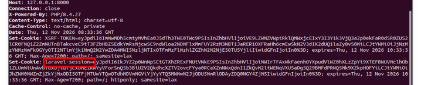
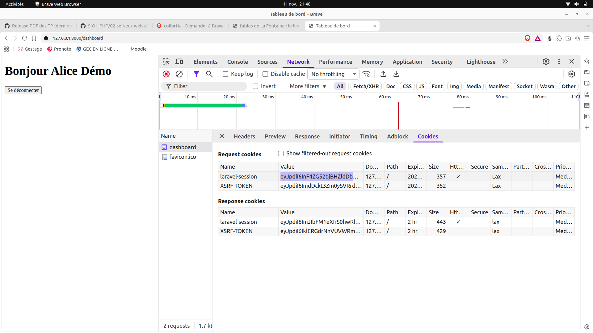

# Étape 3 : Comprendre la connexion : la session

À la fin de cette étape, vous saurez expliquer sur quelles données repose l'affirmation « cet utilisateur est connecté », et ce que la déconnexion signifie réellement.

HTTP n'a pas de mémoire : chaque requête arrive seule, sans lien avec la précédente. Pour répondre 200 à une personne connectée et 302 à un visiteur sur /dashboard, le serveur s'appuie sur deux éléments : une **session**, enregistrée côté serveur, et un **cookie**, conservé par le navigateur. Cette étape les montre dans la base et dans les en-têtes HTTP.


> [!NOTE]
> **Lire un diagramme de séquence.** Un **diagramme de séquence** (UML) montre des échanges dans l'ordre, de haut en bas. Chaque colonne est un acteur (ici le navigateur, Laravel et la base de données). Une flèche pleine est une demande, une flèche en pointillés une réponse.

Avant de commencer les manipulations, assurez-vous que serveur de développement soit lancé dans un terminal et que aucun utilisateur ne soit déconnecté.

**La table `sessions` de la base de données.** 
Deux cas de figure:
- Si vous utiliser MariaDB vous l'utiliserz votre client SQL habituel pour passer les requêtes SQL.  
- Si vous utilisez Sqlite, ouvrez un second terminal dans le projet, lancez la commande suivante: 

```bash
php artisan db
```

> **Pour Sqlite**
> À l'invite, tapez ces deux commandes (elles commencent par un point et ne se terminent pas par `;`) : `.headers on` affiche les noms de colonnes, `.mode column` aligne les colonnes.

Connectez le compte de alice.
Une fois que vous êtes connectez, affichez les colonnes `id` et `user_id` de la table `sessions`


```sql
SELECT id, user_id FROM sessions;
```


> **sqlite3**
> La commande `.quit` ferme la session 


Le résultat montre ici un compte connecté (vos identifiants seront différents) :

```text
id                                        user_id
----------------------------------------  -------
F0drf31Jv8aRz7n0b8Qm2YxLk4TcVhPwUe5sNgDo  1
```


**Observation 1: Le mot de passe en base.**
Ouvrez un 3ème terminal
```bash
php artisan tinker --execute="dump(DB::table('users')->get(['id', 'email', 'password']));"
```

La colonne `password` contient un hash (60 caractères, qui commence par `$2y$`), jamais le mot de passe. À la connexion, Laravel vérifie le mot de passe saisi contre ce hash : on ne « déchiffre » jamais le hash. Les deux comptes de démonstration ont le même mot de passe (`password`) et des hashes différents (voir le mémo ci-dessous).

> [!NOTE]
> **Hash, bcrypt et sel.** Un **hash** est l'empreinte irréversible d'un mot de passe : on peut vérifier qu'un mot de passe correspond à son hash, mais on ne peut pas retrouver le mot de passe à partir du hash. **bcrypt** est l'algorithme de hachage utilisé par Laravel. Le **sel** est une valeur aléatoire ajoutée au mot de passe avant le calcul et inscrite dans le hash : c'est pourquoi deux mots de passe identiques donnent deux hashes différents.

**Observation 2: Ce que le serveur remet à un nouveau visiteur.**

```bash
curl -I http://127.0.0.1:8000/login
```


L'option `-I` n'affiche que les en-têtes de la réponse. Repérez les deux lignes `Set-Cookie` :

- `laravel-session` : le cookie de session. Sa valeur est chiffrée et ne contient aucune information sur vous (ni nom, ni rôle) : seulement de quoi retrouver votre session sur le serveur. L'attribut `httponly` interdit à JavaScript de le lire.
- `XSRF-TOKEN` : un second cookie, lié à la protection CSRF.

**Observation 3: La session d'un visiteur.** Videz d'abord la table des sessions à l'invite (cela déconnecte tout le monde) :

```sql
DELETE FROM sessions;
```

La commande n'affiche rien, elle supprime toutes les lignes de la table sessions.

Dans le navigateur, ouvrez http://127.0.0.1:8000/login sans vous connecter.

Affichez de nouveau la table depuis la base de données `SELECT id, user_id FROM sessions;`.

Vous devez voir **une seule ligne**, avec `user_id` vide : un visiteur a déjà une session, que Laravel crée dès la première visite. Notez le début de son `id`.


**Observation 4:** On va remplacer la méthode  déconnexion de Fortify par un simple appel à logout(). On observera le résultat des tests et le contenu de la table sessions.

Avant de modifier quoi que soit,  notez qu'actuellement la route logout est prise en charge par Fortify.
```bash
php artisan route:list --path=logout
```
Depuis le client SQL, vider la table sessions: `DELETE FROM sessions`

Vous allez maintenant ajouter à la fin du fichier `routes/web.php`le code qui suit. Il porte le même nom et la même méthode que la route de Fortify : la dernière déclarée l'emporte.

   ```php
   // À RETIRER APRÈS L'EXERCICE : déconnexion « maison »
   Route::post('/logout', function () {
       \Illuminate\Support\Facades\Auth::logout();

       return redirect('/');
   })->name('logout');
   ```

Après modification, vérifiez la route logout. 

```bash
php artisan route:list --path=logout

  POST  logout ................................................... logout › routes/web.php:21

```
Elle n'est plus prise en charge par Fortify.

Connectez le compte alice@exemple.test

Copier le cookie `laravel-session`



Remplacer COOKIE par le cookie laravel-session copié depuis le navigateur. 
```bash
php artisan tinker --execute="echo Crypt::decryptString(urldecode('COOKIE'));
```
Vous obtenez 2 valeurs séparé par un | . La seconde valeur l'ID de session. Conservez le ou retenez les 4 permiers caractères.
```bash
 9cf9b40eabd6227930f1336e0acc94dd40058df7|S196lkCWtc0bj7XiO9UXTvbdsHARIM8WoP4L8QGV
```
Affichez de la table sessions `SELECT id, user_id FROM sessions;`

```sql
id                                        user_id
----------------------------------------  -------
S196lkCWtc0bj7XiO9UXTvbdsHARIM8WoP4L8QGV  1  
```

Nous retrouvons bien le meme id de session.


Déconnectez vous depuis le dashbord et affichez la table sessions `SELECT id, user_id FROM sessions;`

```sql
id                                        user_id
----------------------------------------  -------         
S196lkCWtc0bj7XiO9UXTvbdsHARIM8WoP4L8QGV    
```

> [!note]
>  **l'ID de session survécu à la déconnexion**.

Réactivez la prise en charge de la route logout par Fortify (supprimez le code de test de `routes/web.php`).

```bash
php artisan route:list --path=logout
```

Reconnectez vous avec le compte alice@exemple.test.

Affichez de la table sessions `SELECT id, user_id FROM sessions;
```sql
id                                        user_id
----------------------------------------  -------
apC3HEZfS4q08Wl1cR8MwMd8hITpIWsBNaQJr8jt  1   
```

Déconnectez-vous et réaffichez la tables sessions
```sql
id                                        user_id
----------------------------------------  -------
n7xC4EvXIg4ZVblWBC55raxjtB7l4JSNr4IQfK6k  
```

> [!note]
> Cette fois, l'id de session a été changé dès la déconnexion. L'ID de session qui était chiffré dans le cokkie laravel-session n'est plus valable. Il n'est plus possible de réouvrir ou de faire du Session Hijacking (vol de session).
> 


**Pour comprendre ce que fait exactement déconnexion de Fortify.**,  ouvrez le fichier `vendor/laravel/fortify/src/Http/Controllers/AuthenticatedSessionController.php`. 

```php
public function destroy(Request $request): LogoutResponse
{
    $this->guard->logout();

    if ($request->hasSession()) {
        $request->session()->invalidate();
        $request->session()->regenerateToken();
    }

    return app(LogoutResponse::class);
}
```

Elle fait trois choses :

| Appel                                    | Effet                                                                                                                                                                                           |
| ---------------------------------------- | ----------------------------------------------------------------------------------------------------------------------------------------------------------------------------------------------- |
| `$this->guard->logout()`                 | Retire l'utilisateur de la session : la clé `login_web_…` disparaît du payload et `user_id` devient vide. Les autres données de la session sont conservées. C'est ce que fait `Auth::logout()`. |
| `$request->session()->invalidate()`      | Vide toutes les données de la session, supprime de la table la ligne de l'identifiant actuel, puis attribue un nouvel identifiant.                                                              |
| `$request->session()->regenerateToken()` | Remplace le jeton CSRF de la session (`_token`) par un jeton neuf.                                                                                                                              |

`if ($request->hasSession())` réserve les deux derniers appels aux requêtes qui ont une session. `return app(LogoutResponse::class)` renvoie la réponse de déconnexion : la redirection vers /.

Comparez avec l'observation 6 :

| Après la déconnexion  | Fortify (observation 6)          | `Auth::logout()` seul (point 5) |
| --------------------- | -------------------------------- | ------------------------------- |
| `id` de la ligne      | nouveau ; l'ancien n'existe plus | identique                       |
| `user_id`             | vide                             | vide                            |
| Données de la session | vidées par `invalidate()`        | conservées, sauf `login_web_…`  |
| Jeton `_token`        | neuf, par `regenerateToken()`    | identique                       |

Les deux dernières lignes se vérifient avec la commande facultative de l'observation 4 (affichage du payload), lancée avant puis après la déconnexion. Avec `Auth::logout()` seul, `login_web_…` disparaît mais `_token`, `_previous` (dernière adresse visitée) et `password_hash_web` (une empreinte calculée à partir du hash du mot de passe) restent dans la session. Avec Fortify, il ne reste qu'un `_token` neuf et `_flash`.

**Preuve.** Dans PREUVES.md, copiez le message d'échec de l'étape 3 (rouge) et la ligne de résultat avant et après, puis les deux affichages de la table du point 5 (avant et après la déconnexion « maison »).

> **Question 2.** Vous êtes connecté. Quelqu'un copie la valeur de votre cookie `laravel-session` dans son propre navigateur.
>
> 1. Que peut-il faire sans connaître votre mot de passe ?
> 2. Que devient ce cookie si vous cliquez ensuite sur « Se déconnecter » (déconnexion de Fortify) ?
> 3. Même question avec la déconnexion de l'exercice (`Auth::logout()` seul) : que désigne le cookie copié, et que contient la session qu'il désigne ? Quel appel de la méthode `destroy()` de Fortify évite ce résultat ?
> 4. Pourquoi l'identifiant de session change-t-il à la connexion ? La note « Fixation de session » définit l'attaque.
>
> Appuyez-vous sur ce que vous avez observé dans la table `sessions` (observations 3 à 6 et point 5 de l'exercice).
