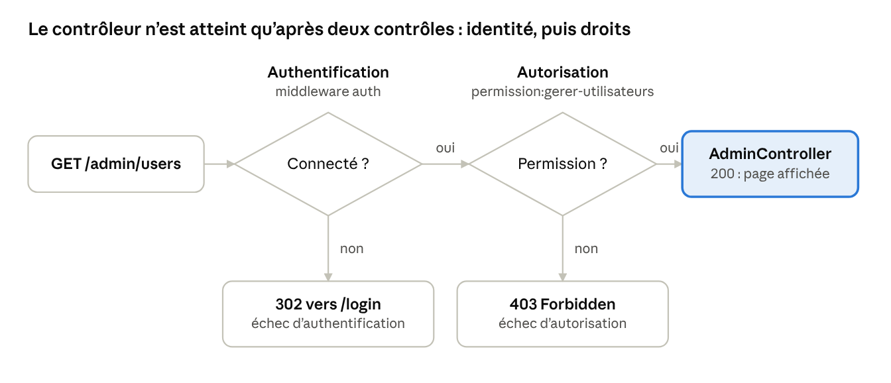

# TP 2 : Autorisation avec Spatie

Avez-vous le droit ? Rôles, permissions et contrôle d'accès.

## Sommaire

- [Présentation](#présentation)
- [Étape 1 : Installer Spatie et préparer le modèle User](etape-1.md)
- [Étape 2 : Créer les rôles, la permission et les comptes de démonstration](etape-2.md)
- [Étape 3 : Attribuer un rôle dès l'inscription (côté serveur)](etape-3.md)
- [Étape 4 : Déclarer les middlewares de Spatie](etape-4.md)
- [Étape 5 : Protéger les routes et compléter les pages](etape-5.md)
- [Contrat de tests](contrat-de-tests.md) (commenté : à lire aussi comme un modèle de test pour vos futurs projets)
- [Dépannage](depannage.md)
- [Bilan — Je sais le prouver](bilan.md)
- Avant : [TP 1 : Authentification avec Fortify](../tp1-authentification/README.md)

# Présentation

Le [TP 1](../tp1-authentification/README.md) a appris à votre application à reconnaître **qui est connecté**. À la fin de ce TP 2, elle sait aussi **ce que chacun a le droit de faire** : trois profils (visiteur, utilisateur, administrateur), des rôles et des permissions, des routes protégées par permission. Comme au TP 1, chaque étape se termine par une preuve à produire.

Vous saurez :

1. Distinguer trois profils : visiteur (non connecté), utilisateur (connecté, droits limités) et administrateur.
2. Modéliser les rôles utilisateur et administrateur avec spatie/laravel-permission, et protéger des routes par permission.
3. Adapter le contenu d'une vue au rôle de la personne qui la consulte.
4. Attribuer un rôle côté serveur, et démontrer qu'un rôle injecté par le client est ignoré.
5. Expliquer et provoquer la réponse 403 de votre application, et la distinguer de la redirection 302.
6. Travailler en boucle avec les tests : en lancer un avant d'agir, lire son message d'échec, agir, relancer. Puis vérifier qu'ils détectent bien une faille, en modifiant volontairement le code.

**Contexte.** Vous continuez le projet tp-auth du TP 1 : il doit avoir ses 20 tests verts. Prérequis : le TP 1 terminé. Le vocabulaire Laravel (route, contrôleur, vue, middleware, modèle, migration) est défini dans le [README du TP 1](../tp1-authentification/README.md#vocabulaire-laravel).

Version de référence :

- Spatie : 8.5.0

**Règle d'or.** Quand un extrait montre un fichier qui existe déjà, vous **ajoutez** ce qui est indiqué. Vous ne remplacez jamais un fichier entier par un extrait : les fichiers générés contiennent des éléments dont l'application a besoin. Les rares exceptions sont signalées dans l'énoncé.

**Vos preuves.** Continuez à copier vos sorties de commandes et vos observations dans le fichier PREUVES.md de votre projet : c'est lui que le bilan vous demande de relire. Pour chaque étape, copiez aussi au moins un test rouge (son message, et la cause en une phrase) puis le même test vert.

## Rappel : authentification, autorisation et codes HTTP

Ce sont deux contrôles distincts, toujours dans cet ordre : d'abord « qui êtes-vous ? » (TP 1), puis « avez-vous le droit ? » (TP 2). Confondre les deux introduit une faille critique dans le contrôle d'accès de votre application.

| Question | Qui êtes-vous ? | Avez-vous le droit de faire ceci ? |
| --- | --- | --- |
| Laravel | **Fortify** (connexion, inscription, session) | **Spatie** (rôles, permissions) |
| Middleware | auth | permission:… |
| Échec vu du navigateur | Redirection 302 vers /login | Erreur 403 Forbidden |

Le contrôleur (ici AdminController) ne peut être atteint qu’après deux vérifications : l’identité, puis les droits :

- Un visiteur (non authentifié) est arrêté au premier contrôle (redirection 302)
- Un utilisateur authentifié est arrêté au second (erreur 403)
- Seul un utilisateur qui a la permission atteint le contrôleur.

**Les codes HTTP de ce TP :**

| Code | Signification | Exemple |
| --- | --- | --- |
| 302 | Redirection : non authentifié | Un visiteur demande /admin/users |
| 403 | Authentifié, mais non autorisé | Un utilisateur demande /admin/users |

## Livrables : la matrice d'accès de l'administration

Voici ce qui est attendu en termes de protection des routes, sous la forme d'une matrice d'accès :

> [!NOTE]
> **Rappel : la matrice d'accès.** Une **matrice d'accès** est un tableau qui croise des **profils** (en colonnes) et des **routes** (en lignes) ; chaque case indique ce que l'application doit répondre à ce profil pour cette route. Ici, lisez la ligne /admin/users : le visiteur est renvoyé vers la connexion (302), l'utilisateur est connecté mais n'a pas le droit (403), l'administrateur voit la page (200). Le TP 1 a présenté ce principe avec les profils visiteur et personne connectée.

| Route | Visiteur | Utilisateur | Administrateur |
| --- | --- | --- | --- |
| /admin/users | 302 vers /login | 403 | 200 |

Les 3 cases deviennent les 3 cas du test test\_la\_matrice\_d\_acces\_est\_respectee, à l'étape 5.

Les pages du TP 1 (/accueil, /login, /dashboard) gardent leur comportement. L'accueil et le tableau de bord affichent en plus un contenu propre au rôle.

## Qui fait quoi : Spatie et vous

Spatie enregistre qui a quel rôle et quelles permissions, mais ne décide pas à votre place de ce qui doit être protégé.

| Spatie fournit | Vous décidez ou écrivez |
| --- | --- |
| Les tables des rôles et des permissions, et les méthodes assignRole(), hasRole(), can()… | Quels rôles et quelles permissions existent |
| Les middlewares role, permission et role\_or\_permission, et la directive @role | Les alias de middlewares dans bootstrap/app.php, et quelle permission protège quelle route |
| Le branchement de la méthode can() et de la directive @can (qui sont des outils de Laravel) sur les permissions | Les règles métier, par exemple le rôle attribué à l'inscription |

> [!NOTE]
> **Alias de middleware.** Un **alias** est un nom court (par exemple permission) qui désigne une classe de middleware. L'étape 4 déclare les alias dans bootstrap/app.php.
