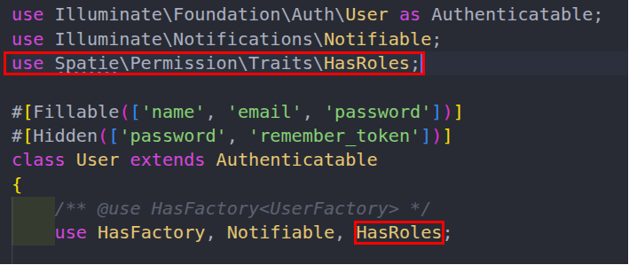

# Étape 1 : Installer Spatie et préparer le modèle User

À la fin de cette étape, Spatie est installé, ses cinq tables existent et le modèle User dispose des méthodes de rôles.

Ce TP continue le projet tp-auth du [TP 1](../tp1-authentification/README.md) : placez-vous dans son dossier. Avant de commencer, les 20 tests du TP 1 doivent être verts (php artisan test --filter=AuthenticationTest).

## Installer le contrat de tests

Comme au TP 1, vous commencez par les tests et vous suivez la même boucle : prédire, lancer le test avant d'agir, lire le message d'échec, agir, relancer. Créez tests/Feature/AuthorizationTest.php et copiez-y, sans rien changer, le fichier donné dans le [Contrat de tests](contrat-de-tests.md).

**Lancer**

```bash
php artisan test --filter=AuthorizationTest
```

Les 14 tests échouent avec le même message : `Target class [Database\Seeders\RoleSeeder] does not exist.` La méthode setUp() du contrat lance RoleSeeder avant chaque test. Tant que cette classe n'existe pas (étape 2), aucun test n'exécute son propre code : un seul message pour 14 tests.

Les 20 tests du TP 1 doivent, eux, rester verts tout au long du TP 2. Une seule adaptation de leur préparation sera nécessaire, à l'étape 3, et elle y est expliquée.

**Preuve.** Dans PREUVES.md, notez le message et le nombre de tests rouges.

## Installer Spatie

Le package spatie/laravel-permission crée cinq tables en base via une migration unique (2 tables de définition + 3 tables de liaison).

| Table | Rôle |
| --- | --- |
| permissions | Catalogue des permissions (ex. edit posts, delete users). Clé unique : name + guard\_name. |
| roles | Définition des rôles (ex. admin, editor). Chaque rôle regroupe un ensemble de permissions. |
| role\_has\_permissions | Pivot N-to-N entre rôles et permissions : Un rôle contient quel droit ? |
| model\_has\_roles | Pivot polymorphe : quel modèle (User, ApiClient…) a quel rôle. Colonnes : role\_id, model\_type, model\_id. |
| model\_has\_permissions | Pivot polymorphe : permissions attribuées directement à un modèle, sans passer par un rôle (cas rare). |

> [!NOTE]
> **Vocabulaire de la base de Spatie.** Une table **pivot** (ou table de liaison) relie deux autres tables ; **N-to-N** signifie « plusieurs à plusieurs » (un rôle regroupe plusieurs permissions, une permission peut appartenir à plusieurs rôles) ; **polymorphe** signifie que la même table peut relier des modèles de types différents, la colonne model\_type indiquant lequel. Enfin, un **guard** est le mécanisme par lequel Laravel authentifie les utilisateurs : guard\_name vaut `web` ici, le guard à sessions qu'utilise Fortify.

**Pourquoi cette architecture ?**

Les permissions ne sont pas stockées sur le modèle User, afin de permettre de réutiliser le même système pour n'importe quel modèle Eloquent (utilisateurs, API clients, service accounts…).

Le check ($user->can('edit posts')) vérifie à la fois les permissions directes (model\_has\_permissions) et celles héritées via les rôles (model\_has\_roles → role\_has\_permissions).

Spatie met les permissions en cache : il les charge en mémoire à la première vérification et invalide le cache à chaque création ou modification de rôle ou de permission.

**En résumé (le flux)**

```text
User ──(model_has_roles)──► Role ──(role_has_permissions)──► Permission
  │
  └──(model_has_permissions)──► Permission (direct, rare)
```

L'utilisateur hérite de toutes les permissions de ses rôles, plus celles qu'on lui a accordées directement. C'est le patron classique du RBAC, implémenté en N-to-N polymorphe pour rester découplé du modèle utilisateur.

> [!NOTE]
> **RBAC.** RBAC (*Role-Based Access Control*) est le contrôle d'accès fondé sur les rôles : on ne donne pas des droits à chaque personne, on donne des droits à des rôles, puis des rôles aux personnes.

**Faire**

```bash
composer require spatie/laravel-permission
php artisan vendor:publish --provider="Spatie\Permission\PermissionServiceProvider"
php artisan config:clear
php artisan migrate
```

| Commande | Effet |
| --- | --- |
| composer require | Télécharge le package dans vendor/. Laravel détecte son service provider et l'enregistre. |
| vendor:publish --provider=… | Copie dans votre projet le fichier config/permission.php (réglages : cache, noms des tables) et une migration dans database/migrations. |
| config:clear | Supprime la configuration mise en cache, s'il y en a une, pour que Laravel lise le nouveau fichier config/permission.php. |
| migrate | Exécute la migration : crée les cinq tables. |

**Vous devez voir :** pour composer require, la ligne `Using version ^8.5 for spatie/laravel-permission` puis la fin de l'installation sans message d'erreur ; pour vendor:publish, deux lignes `Copying file … DONE` (config/permission.php et une migration `…_create_permission_tables.php`) ; pour config:clear, `INFO Configuration cache cleared successfully.` ; pour migrate, une ligne `…_create_permission_tables … DONE`.

**Lancer (avant d'agir).** Les tables existent. Appelez une méthode de Spatie sur un compte existant :

```bash
php artisan tinker --execute="var_dump(App\Models\User::first()->hasRole('administrateur'));"
```

Le message est `Call to undefined method App\Models\User::hasRole().` Les méthodes de Spatie n'existent pas encore sur le modèle User.

**Faire.** Dans app/Models/User.php, ajoutez **l'import** et le **trait** HasRoles. Un trait ajoute à la classe qui l'utilise un ensemble de méthodes (voir le mémo plus bas) : HasRoles donne au modèle User les méthodes de Spatie pour les rôles et les permissions.



**Relancer** la même commande : elle affiche `bool(false)`. La méthode existe, et le compte n'a pas le rôle administrateur (aucun rôle n'existe encore).

Le trait HasRoles ajoute au modèle les méthodes de Spatie : assignRole(), hasRole(), syncRoles()… La méthode can(), déjà présente, tient alors compte des permissions Spatie (voir le mémo).

> [!NOTE]
> **Le trait *HasRoles***
>
> En PHP, une classe n’hérite que d’**une seule** classe parente. *User* hérite déjà de *Authenticatable* : on ne peut pas lui ajouter un second *extends*.
>
> Le **trait** contourne cette limite. C’est un bloc de méthodes que PHP recopie dans la classe qui l’utilise. En écrivant *use HasRoles;* dans *User*, le modèle reçoit *roles()*, *assignRole()*, *hasRole()*, *syncRoles()*, *givePermissionTo()*… sans qu’on réécrive une ligne.
>
> *can()*, lui, existe déjà dans *User* : il vient du trait *Authorizable*, inclus dans *Authenticatable*. Il interroge le **Gate** de Laravel, le composant qui décide des autorisations. Spatie ajoute au Gate un contrôle préalable qui appelle la méthode *checkPermissionTo()* du trait *HasRoles*. Sans le trait, cette méthode n’existe pas : *can()* répond *false* pour les permissions Spatie, **sans aucune erreur**.

> [!WARNING]
> Attention aux deux *use* : celui en haut du fichier **importe un nom** (permet d’écrire ***HasRoles*** au lieu de ***\\Spatie\\Permission\\Traits\\HasRoles***), celui dans la classe **inclut le trait** **à la classe User**.

**Preuve**

`db:table` affiche la structure d'une table : ses colonnes, ses index et ses clés étrangères.

```bash
php artisan db:table model_has_roles
```

**Vous devez voir :** 3 colonnes (`role_id` integer, `model_type` varchar, `model_id` integer), des index (dont un sur `model_id` et `model_type`), et une clé étrangère de `role_id` vers la table roles. Copiez la liste des colonnes dans PREUVES.md et indiquez, pour chacune des trois colonnes (role\_id, model\_type, model\_id), ce qu'elle désigne.
